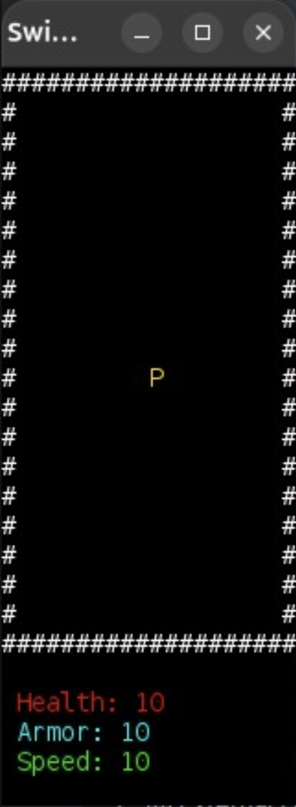
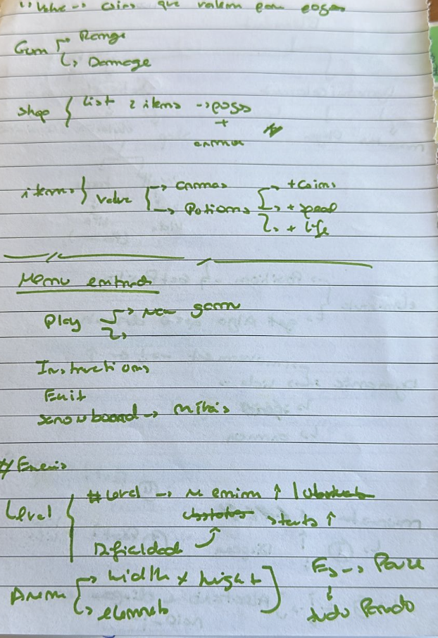
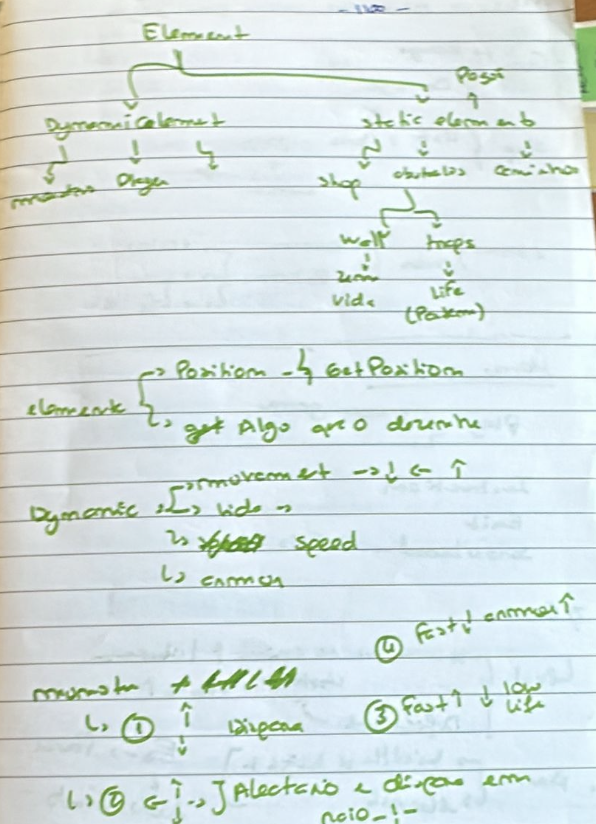

# LDTS_T03_G05 - Claw Crawler

## Game Description

Claw Crawler is a dungeon-crawler game based on traditional fantasy tropes. The gameplay sees the player character navigating a series of maze-like environments while climbing and fighting down a dungeon. Throughout the levels the player levels up and gains new abilities that allow them to defeat increasingly powerful enemies.

This project was developed by Bernardo Barbosa (up202403438@edu.fe.up.pt), João Fardilha (up202403383@edu.fe.up.pt) and Pedro Santos (up202405319@edu.fe.up.pt)

## Implemented features

- Dungeon environment

## Planned features

- Different enemies with different attacks
- Player input
- Different dungeon levels with increasing difficulty
- Item shop
- Currency system
- Chests
- Equipment (weapons/armour)
- Menu
- Scoreboard

## Design

### General structure

#### Current general UML explanation

The game has different states (such as a game state and a menu state), each with its own controller and viewer. The model layer consists of elements such as the dungeon, menu, player, monsters, walls, and positions.
The main goal is to separate responsibilities:
- State: decides which controller and viewer are active.
- Controller: handles input and updates the model.
- Viewer: renders the model to the screen.
- Model: represents the game world and its elements.

##### Mockup 

- **Mockup 1:** Run test mockup  

- **Mockup 2:** Thinking / write-hand mockup 

- **Mockup 3:** Thinking / write-hand mockup

##### Game and state layer

Game is the central class that holds the current game state and delegates operations to the active state object.

State<T> is an abstract, generic state representing a specific phase of the game, it has a step(game, gui, time) method that is responsible for progressing the game, usually by calling the controller. The State<T> also exposes two methods:
- getController(): returns the controller associated with the state.
- getViewer(): returns the viewer.

GameState and MenuState are concrete states that extend State.
GameState uses:
- A Dungeon as its model.
- A GameController. 
- A GameViewer.
MenuState uses:
- A Menu as its model.
- A MenuController.
- A MenuViewer.

##### Controller Layer

- Controller<T> is a generic abstract controller which contains a step(game, action, time) method and is responsible for processing input actions and updating the model.
- GameController manages the game world logic during gameplay (moving the player, updating monsters, etc.).
- MenuController handles menu navigation.

##### Viewer Layer
Viewer<T> is an abstract viewer responsible for drawing a specific type of model whose subclasses must implement how their model is displayed.

GameViewer: draws the entire game dungeon and its elements.

MenuViewer: draws the menu.

ElementViewer<T> is a generic viewer used to draw individual game elements.

PlayerViewer, WallViewer, and MonsterViewer are concrete element viewers that know how to draw:
- The player
- A wall
- A monster

##### Input Layer

PlayerAction: Describes the actions available to the player (for example, movement directions or selections). Controllers use this to update the model.

##### Model Layer

- DungeonLevel is a higher-level structure that may include multiple areas or levels.
- Dungeon represents the active game area and contains the player, walls, monsters, and other elements.
- Menu represents the menu model.
- Element is the base class for anything located in the dungeon.
- Player, Wall, and Monster are concrete elements and monster references MonsterType, which defines its attributes and behavior.
- Position holds x and y coordinates for placing elements within the dungeon.
