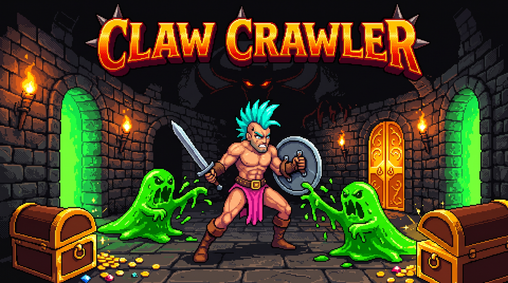
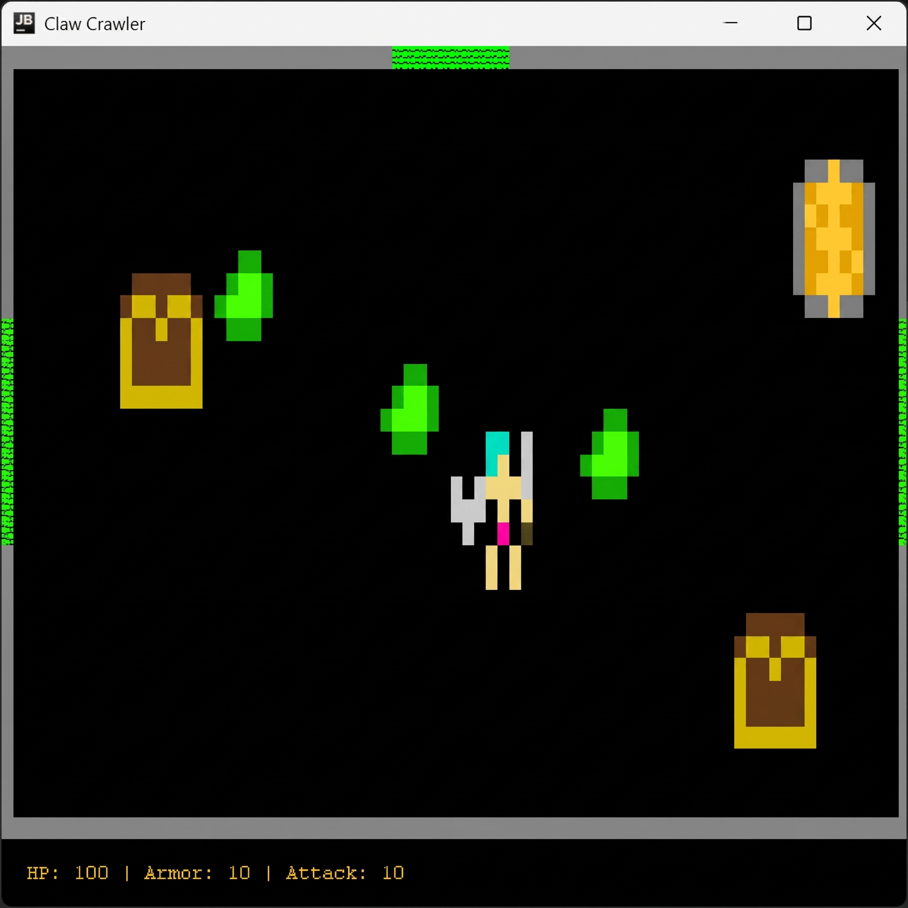
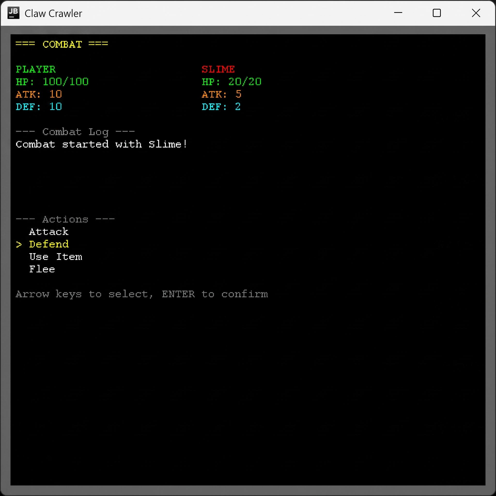
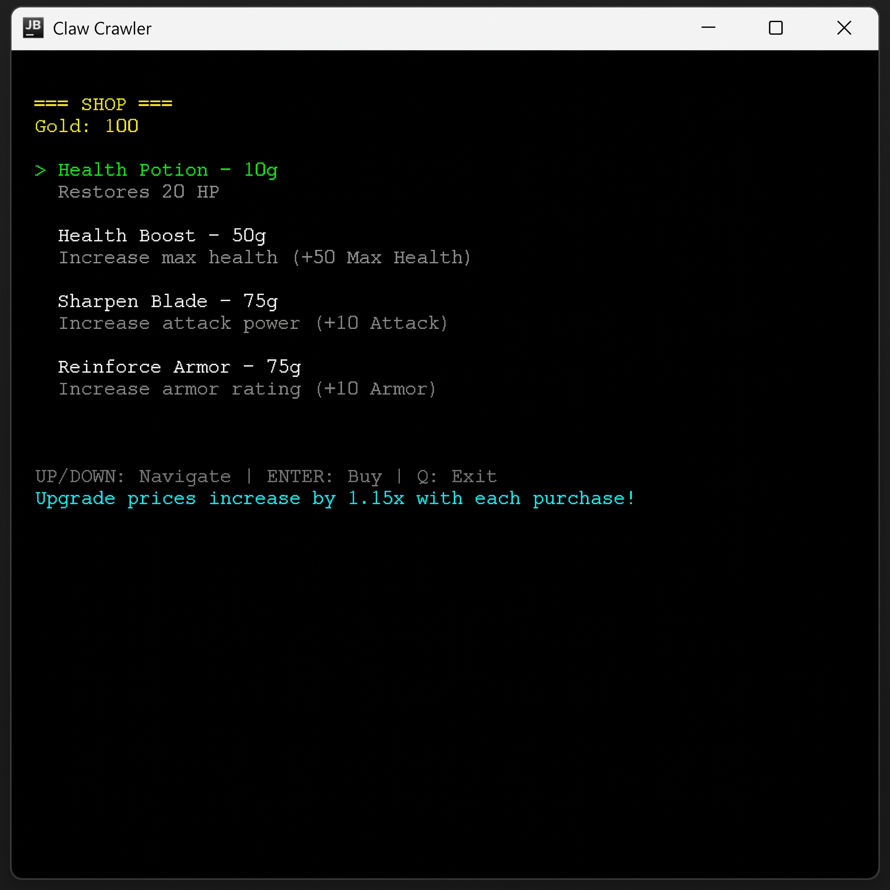
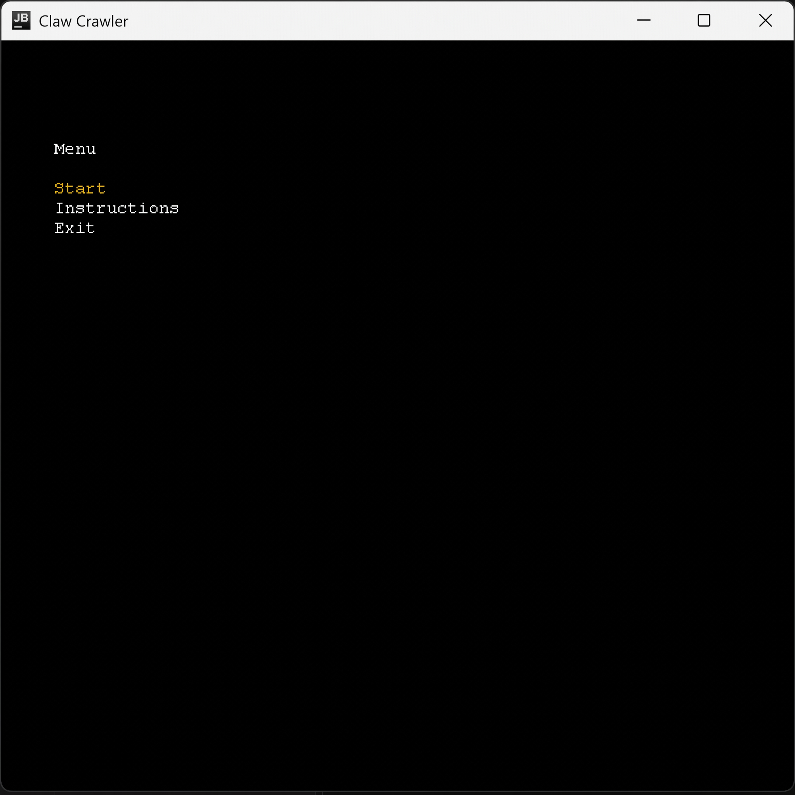
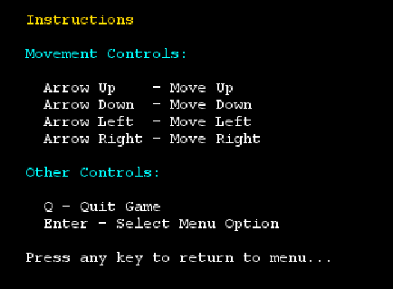
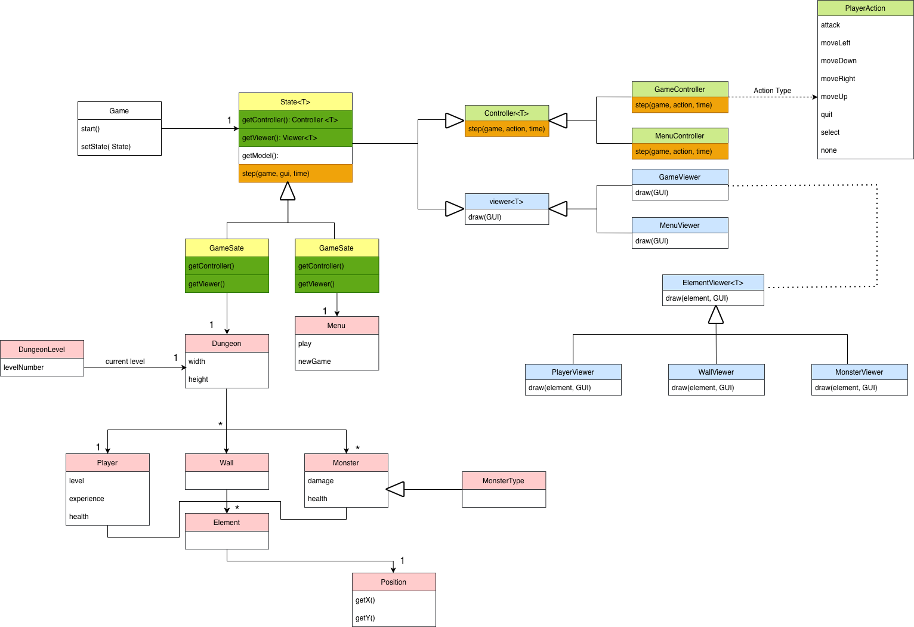
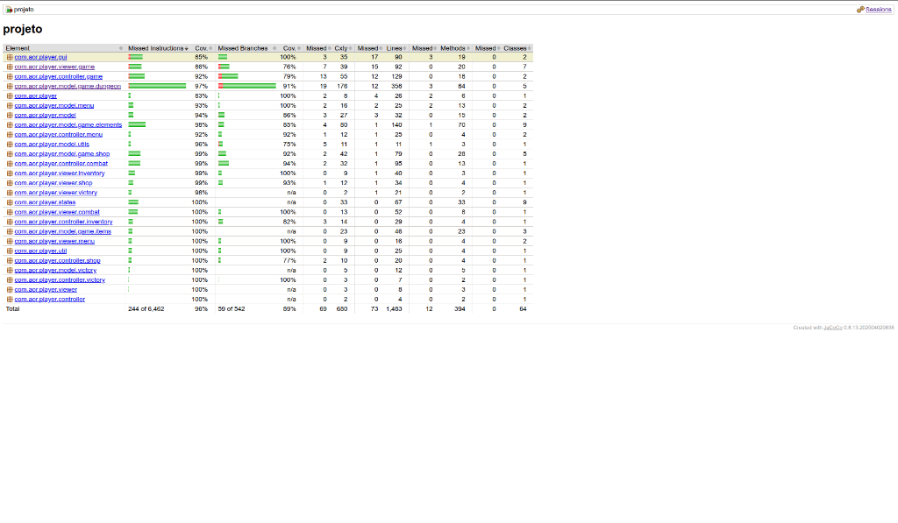
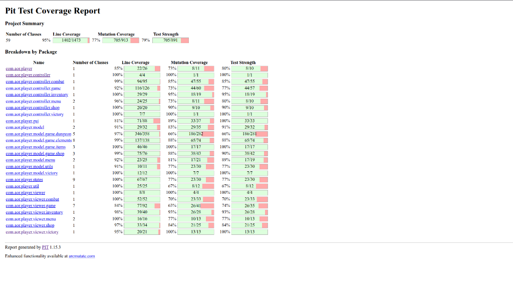

<p align="center">
  
</p>

# Claw Crawler

## Game Description

Claw Crawler is a dungeon-crawler game based on traditional fantasy tropes. The gameplay sees the player character navigating a series of maze-like environments while fighting his path out. Throughout the rooms the player gains gold that allows them to improve their stats (and their odds) against increasingly difficult enemy encounters.

This project was developed by Bernardo Barbosa, João Fardilha and Pedro Santos

## Gameplay

<p align="center">
  
  
</p>
<p align="center">
  
  
</p>

## Implemented features

- Dungeon environment - A dark background with grey walls;
- Item shop - Where players may buy items to help them with their stats and journey;
- Menu - The place where the player may exit the game, start it or read the instructions in order to know what to do;
- Currency - A coin-based system that allows players to customize their stats and allowing for the playstyle that suits them best;
- Room differences - Different dungeon rooms with increasing difficulties;
- Enemy variety - 4 types of enemies, each with different sprites and stats.
- Inventory - A system that allows players to store items and use them in combat.
- Final screen - A screen that shows the player's final score and allows them to exit the game.

## Build and Run

### Requirements
- Java 17 or newer (JDK) 
- A terminal that supports Lanterna (any modern terminal; use a window of at least 80x24)

### Run
```bash
git clone https://github.com/BERgod27/Claw-Crawler.git
cd Claw-Crawler
./gradlew run        # on Windows: gradlew.bat run
```

### Tests and reports
```bash
./gradlew test            # unit tests
./gradlew jacocoTestReport   # coverage report
./gradlew pitest          # mutation testing
```

## Design

### Instructions

The player controls a hero who sports a blue mohawk and has both a sword and a shield by his side to assist him in his adventures.
The hero spawns in a dark room with chests, green slimes and a shop. To use the shop, the hero must get gold, in order to get gold he must open the chests and defeat monsters. The shop is the best tool in the hero's arsenal to complete his final goal, to kill the demon king, as it is used to improve his stats.
In order for the hero to defeat the demon king, he must unlock his room (the one in the north), but for that he must defeat the vampire (western room) and the troll (eastern room).

### Controls



### General structures
#### Current general UML explanation

The game has different states (such as a game state and a menu state), each with its own controller and viewer. The model layer consists of elements such as the dungeon, menu, player, monsters, walls, and positions.
The main goal is to separate responsibilities:
- State: decides which controller and viewer are active.
- Controller: handles input and updates the model.
- Viewer: renders the model to the screen.
- Model: represents the game world and its elements.



##### Game and state layer

Game is the central class that holds the current game state and delegates operations to the active state object.

State<T> is an abstract, generic state representing a specific phase of the game, it has a step(game, gui, time) method that is responsible for progressing the game, usually by calling the controller. The State<T> also exposes two methods:
- getController(): returns the controller associated with the state.
- getViewer(): returns the viewer.

GameState and MenuState are concrete states that extend State.
GameState uses:
- A Dungeon as its model.
- A GameController. 
- A GameViewer.
MenuState uses:
- A Menu as its model.
- A MenuController.
- A MenuViewer.

##### Controller Layer

- Controller<T> is a generic abstract controller which contains a step(game, action, time) method and is responsible for processing input actions and updating the model.
- GameController manages the game world logic during gameplay (moving the player, updating monsters, etc.).
- MenuController handles menu navigation.

##### Viewer Layer
Viewer<T> is an abstract viewer responsible for drawing a specific type of model whose subclasses must implement how their model is displayed.

GameViewer: draws the entire game dungeon and its elements.

MenuViewer: draws the menu.

ElementViewer<T> is a generic viewer used to draw individual game elements.

PlayerViewer, WallViewer, and MonsterViewer are concrete element viewers that know how to draw:
- The player
- A wall
- A monster

##### Input Layer

PlayerAction: Describes the actions available to the player (for example, movement directions or selections). Controllers use this to update the model.

##### Model Layer

- DungeonLevel is a higher-level structure that may include multiple areas or levels.
- Dungeon represents the active game area and contains the player, walls, monsters, and other elements.
- Menu represents the menu model.
- Element is the base class for anything located in the dungeon.
- Player, Wall, and Monster are concrete elements and monster references MonsterType, which defines its attributes and behavior.
- Position holds x and y coordinates for placing elements within the dungeon.

## Design Patterns

### State Pattern
**Problem:** The game needs to handle different screens (menu, gameplay, combat, shop, inventory, victory) each with different behaviors and rendering.

**Solution:** We implemented the State Pattern using an abstract `State<T>` class. Each game phase (MenuState, GameState, CombatState, ShopState, InventoryState, VictoryState) extends State and provides its own controller and viewer.

**Consequences:**
- Easy to add new game states without modifying existing code
- Each state encapsulates its own logic cleanly
- State transitions are explicit and controlled

**Classes involved:** `State`, `GameState`, `MenuState`, `CombatState`, `ShopState`, `InventoryState`, `VictoryState`, `InstructionsState`

### Factory Pattern
**Problem:** Creating complex objects like States and Monsters involves multiple dependencies and initialization logic.

**Solution:** We use Factory classes to centralize object creation:
- `StateFactory` creates all state objects with proper dependencies
- `MonsterFactory` creates monsters with the correct stats based on type
- `DungeonFactory` creates complete dungeon configurations

**Consequences:**
- Decouples object creation from usage
- Easy to modify creation logic in one place
- Improves testability through dependency injection

**Classes involved:** `StateFactory`, `MonsterFactory`, `DungeonFactory`

### Model-View-Controller (MVC)
**Problem:** Need separation between game data, rendering, and input handling.

**Solution:** We follow MVC architecture:
- **Model:** `Dungeon`, `Player`, `Monster`, `Menu`, `Shop`, etc.
- **View:** `GameViewer`, `MenuViewer`, `CombatViewer`, etc.
- **Controller:** `DungeonController`, `MenuController`, `CombatController`, etc.

**Consequences:**
- Clear separation of concerns
- Views can be changed without affecting game logic
- Controllers can be tested independently

### Game Loop Pattern
**Problem:** The game needs continuous updates and rendering at a consistent frame rate.

**Solution:** The `Game` class implements a game loop that:
1. Processes input
2. Updates game state via controller
3. Renders via viewer
4. Maintains consistent frame timing

**Consequences:**
- Consistent game speed regardless of hardware
- Predictable update and render cycle
- Clean separation of timing from game logic

**Classes involved:** `Game`

### Strategy Pattern (Items)
**Problem:** Items need different behaviors (equippable vs usable) that can vary independently.

**Solution:** We use interfaces as strategies:
- `Usable` interface for consumable items (HealthPotion)
- `Equippable` interface for equipment (Sword, Armor)

**Consequences:**
- Items can implement multiple behaviors
- New item types are easy to add
- Runtime polymorphism for item usage

**Classes involved:** `Item`, `Usable`, `Equippable`, `HealthPotion`, `Sword`, `Armor`

## Code Smells

The following code smells have been identified in the codebase:

### Long Method
- **DungeonController.step()**: The step method handles many different actions in a large switch statement.
- **RoomGenerator.createWallsFromRooms()**: Multiple nested loops for wall generation.

### Large Class
- **Dungeon**: This class handles room management, player movement, monster tracking, and shop interaction. Could be split into smaller components with single responsibilities.

### Feature Envy
- **CombatController**: Accesses Player and Monster internals frequently. Combat logic could be moved to a dedicated Combat model class.

### Duplicate Code
- **Movement methods in DungeonController**: `movePlayerUp()`, `movePlayerDown()`, `movePlayerLeft()`, `movePlayerRight()` share similar structure. Could use a single method with direction parameter.

### Magic Numbers
- **RoomGenerator**: Uses hardcoded values like `numRooms * 10` for max attempts. Should be extracted to named constants.
- **CombatController**: Combat formulas use magic numbers for damage calculations.

### Primitive Obsession
- **Position handling**: Many methods take separate x, y parameters instead of Position objects.

## Coverage Report

### Code Coverage (JaCoCo)



### Mutation Coverage (Pitest)



**Note on Surviving Mutations:** The remaining ~23% of mutations that survive are primarily in areas that are challenging to test without significant refactoring:
- **Timing logic in Game.java**: Testing `System.currentTimeMillis()` and `Thread.sleep()` calls would require mocking static methods
- **Random behavior**: Monster movement uses `Random` which produces non-deterministic results
- **GUI interactions in LanternaGUI**: Direct terminal I/O is difficult to unit test
- **Log/print statements**: Calls to `addLogEntry()` in CombatController don't affect functional behavior


